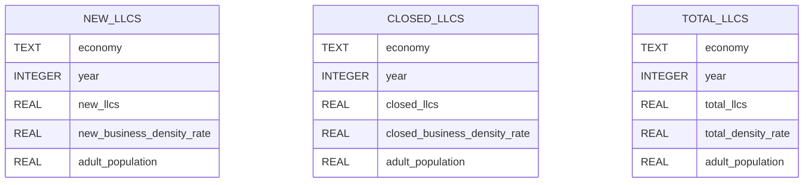

# Global Business Intelligence (GBI)

## Objective
Build a data-driven system to investigate global business formation
and evaluate business opportunities across countries and continents.

## Data source
World Bank Entrepreneurship Database 2025.

## Database Architecture
The Global Business Intelligence (GBI) project uses three datasets from the World Bank Entrepreneurship Database 2025:
- New LLC registrations
- Closed LLC registrations
- Total LLC registrations

### Entity Relationship Diagram (ERD)

The diagram below represents the initial PostgreSQL database structure.

**Note:** Economy and year are candidate composite keys for each dataset. Relationships between the tables have not yet been formally defined.

## Technology
- PostgreSQL
- DBeaver
- SQL
- Python
- pandas

## Progress
- [x] PostgreSQL database created
- [x] Three datasets imported
- [x] Column names standardised
- [x] Duplicate country-year checks completed
- [x] Missing-value investigation
- [x] Dataset integration
- [x] Country comparisons
- [x] Business opportunity analysis
